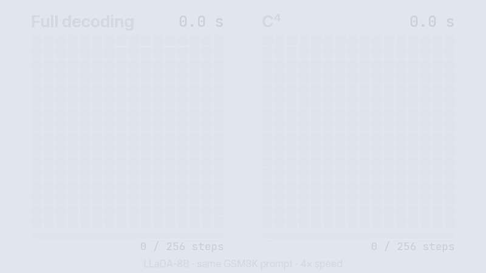
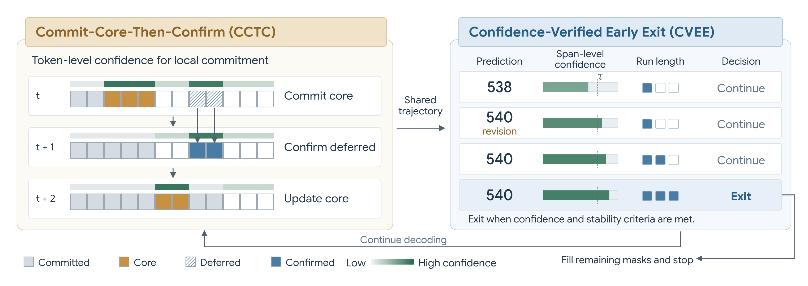

<h1 align="center">C⁴: Commit Locally, Exit Globally</h1>

<p align="center"><b>Coordinating Adaptive Sampling and Early Exit in Diffusion Language Models</b><br>
Training-free faster decoding for diffusion LLMs: commit confident tokens sooner, and stop once the answer has settled.</p>

<p align="center">
<a href="https://ming053l.github.io/">Chia-Ming Lee</a><sup>1,2</sup>,
Shao-Kai Liu<sup>1</sup>,
<a href="https://www.albany.edu/faculty/mchang2/">Ming-Ching Chang</a><sup>2</sup>,
<a href="https://scholar.google.com/citations?user=gMBvzGoAAAAJ&hl=en">Xin Li</a><sup>2</sup>,
<a href="https://yulunalexliu.github.io/">Yu-Lun Liu</a><sup>1</sup>,
<a href="https://cchsu.info/">Chih-Chung Hsu</a><sup>1</sup>
</p>

<p align="center">
<sup>1</sup>National Yang Ming Chiao Tung University<br>
<sup>2</sup>University at Albany, SUNY
</p>

<p align="center">
<a href="https://ming053l.github.io/c4-dllm.github.io/"></a>
<a href="paper/C4_preprint.pdf"></a>
<a href="https://arxiv.org/abs/2607.28166"></a>
<a href="https://youtu.be/R1kKAmhyGPQ"></a>
<a href="LICENSE"></a>
</p>

<p align="center"><br>
<sub>The same GSM8K prompt on LLaDA-8B-Instruct, replayed from recorded runs at 4× speed (one RTX 3090). More replays, including Prophet, SlowFast and WINO, are on the <a href="https://ming053l.github.io/c4-dllm.github.io/">project page</a>.</sub></p>

## What it does

A diffusion language model predicts every position in parallel and shows a full provisional output at every step,
yet full decoding still runs every scheduled step. Earlier speed-ups do one of two things, and each breaks somewhere:

- **Stop early** (Prophet, SchED): the stop rule follows decoding progress or a fixed confidence threshold, so
  reasoning is cut off while the answer is still changing (Prophet on LLaDA GSM8K: 66 → 38 accuracy).
- **Commit faster** (Fast-dLLM, SlowFast, KLASS, WINO): blocks finish sooner, but every block is still decoded after
  the answer is done (on MMLU these reach at most 4.3×; C⁴ reaches 16.1×).

C⁴ makes both decisions, separately, on one trajectory:

- **CCTC** (*Commit-Core-Then-Confirm*, local): in the active block, confident positions next to the resolved
  boundary commit at once; confident positions further right are deferred and commit one step later only if they
  still predict the same token. No extra forward pass.
- **CVEE** (*Confidence-Verified Early Exit*, global): at every step a fixed parser reads the current answer; decoding
  stops once its confidence is ≥ 0.7 and it has stayed unchanged for max(3, ⌈2 × changes⌉) steps.

<p align="center"></p>

## Results

One frozen setting, calibrated once on LLaDA and reused unchanged on Dream. Decoding-loop speedup over full decoding
(tokens/s, one RTX 4090) and accuracy change in points:

| Task | LLaDA-8B | Dream-7B | | Task | LLaDA-8B | Dream-7B |
|---|---|---|---|---|---|---|
| MMLU | 16.13× (±0.0) | 13.82× (−1.5) | | GSM8K | 3.55× (−2.0) | 4.82× (±0.0) |
| ARC-C | 14.30× (±0.0) | 17.35× (+1.0) | | MATH | 2.62× (+1.0) | 2.76× (±0.0) |
| HellaSwag | 16.76× (±0.0) | 13.48× (±0.0) | | SVAMP | 4.29× (±0.0) | 5.28× (−1.0) |
| WinoGrande | 18.64× (±0.0) | 15.81× (±0.0) | | ASDiv | 4.48× (+3.0) | 6.31× (−2.0) |
| PIQA | 15.53× (+0.5) | 17.71× (+0.5) | | GSM-Hard | 3.60× (+2.0) | 3.99× (+3.0) |
| HumanEval | 8.70× (+1.8) | 10.07× (−1.8) | | MBPP | 11.09× (±0.0) | 13.42× (±0.0) |

64–95% fewer decoding steps; no task–model setting loses more than 2 accuracy points. Baselines (Prophet, SchED,
SlowFast, KLASS, WINO) and ablations are in the [paper](paper/C4_preprint.pdf).

## Install

```bash
git clone https://github.com/ming053l/C4-dLLM.git && cd C4-dLLM
pip install -r requirements.txt   # the versions the paper's numbers were produced with
```

The backbones are downloaded from the Hugging Face Hub on first use (`trust_remote_code=True` pulls
their own modeling code). One 24 GB GPU is enough for either at the shapes used here.

| `--model` | checkpoint |
|---|---|
| `llada` | [`GSAI-ML/LLaDA-8B-Instruct`](https://huggingface.co/GSAI-ML/LLaDA-8B-Instruct) |
| `dream` | [`Dream-org/Dream-v0-Instruct-7B`](https://huggingface.co/Dream-org/Dream-v0-Instruct-7B) |

## Quick start

C⁴ with the deployed setting, on MMLU:

```bash
python run_task.py --task mmlu --model llada \
    --struct-mode window --holes 1 --confirm --block-accel-tau 0.8 --final-too \
    --out out/mmlu_c4.json
```

The same model with both gates off: full decoding, the baseline every speedup is measured against.

```bash
python run_task.py --task mmlu --model llada --no-cvee --no-block-rule --out out/mmlu_base.json
```

On LLaDA/MMLU the two print `acc=0.6400  nfe=4.82/64` and `acc=0.6400  nfe=64.00/64`: same accuracy,
92.5% of the steps gone. Swap `--task` for any of `mmlu arc_c hellaswag winogrande piqa gsm8k math
svamp asdiv gsmhard humaneval mbpp`, and `--model dream` for the second backbone.

> Code tasks run model-written programs. Each runs in its own subprocess, temp directory and
> process group with a timeout, which keeps a bad program from hanging the evaluation; it is not a
> security sandbox, so run untrusted generations inside a container.

## Use C⁴ in your own code

```python
import torch
from transformers import AutoModel, AutoTokenizer
from c4 import generate, CCTCConfig, CVEEConfig
from c4.tasks import build_chat_prompt, EXTRACTORS, SEARCH_MODE

name = "GSAI-ML/LLaDA-8B-Instruct"
tokenizer = AutoTokenizer.from_pretrained(name, trust_remote_code=True)
model = AutoModel.from_pretrained(name, trust_remote_code=True,
                                  torch_dtype=torch.bfloat16).to("cuda").eval()

question = "Q: A juggler can juggle 16 balls. Half of the balls are golf balls, and half of the golf balls are blue. How many blue golf balls are there?\nA: Let's think step by step."
prompt = torch.tensor(tokenizer(build_chat_prompt(tokenizer, question))["input_ids"],
                      device="cuda").unsqueeze(0)

result = generate(
    model, tokenizer, prompt, gen_length=256, steps=256, block_length=32,
    cctc=CCTCConfig(),                                   # local: deployed CCTC defaults
    cvee=CVEEConfig(extractor=EXTRACTORS["gsm8k"],       # global: how to read the answer
                    search_mode=SEARCH_MODE["gsm8k"]),
)
print(result.text)
print(result.steps, "of", result.step_budget, "steps; per block:", result.block_steps)
```

- `cctc=None` or `cvee=None` turns that half off; with both off, `generate` is the reference decoder.
- For Dream, pass `mask_id=151666, logit_shift=True`.
- Your own task only needs an `extractor(text) -> str | None` that returns the answer from the
  decoded text, and a `search_mode`: `"last"` (answers that close the response), `"first5"`
  (a choice letter at the start) or `"code"` (a function anywhere in the output).
- Already have a decoder you don't want to replace (e.g. WINO)? `c4.CVEETracker` is the exit gate
  alone: call `tracker.step(x0, conf)` once per step with the argmax and its probability; it returns
  `True` when the sequence may be filled and stopped.
- `c4.generate_live(...)` keeps the flat keyword interface of the first release and returns
  `(text, steps_used, steps_budget, per_block_steps)`.

## Configuration

The deployed setting is one frozen tuple, used unchanged for every task and both backbones
(paper Sec. 5). The CLI defaults keep the original release's behaviour, so the deployed run needs the
flags shown in Quick start; `CCTCConfig()` and `CVEEConfig()` default to the deployed values.

| | value | what it controls |
|---|---|---|
| `--block-accel-tau` | `0.8` | τ_CCTC: confidence a position needs before CCTC may commit it |
| `--struct-mode window` | | commit only the boundary-anchored core (`off` = commit every confident position, as Fast-dLLM) |
| `--holes` | `1` | H: unresolved positions the core may step over |
| `--confirm` | on | deferred positions commit one step later if they still predict the same token |
| `--final-too` | on | accelerate every block, including the last |
| CVEE τ / γ / p_min | `0.7 / 2.0 / 3` | stop when confidence ≥ τ and the answer has been unchanged for ≥ max(p_min, ⌈γ · changes⌉) steps |

<details>
<summary>All <code>run_task.py</code> flags</summary>

| flag | default | meaning |
|---|---|---|
| `--task` | required | one of the 12 tasks above |
| `--model` | `llada` | `llada` or `dream` |
| `--n` | 200 short-answer · 100 reasoning · 164 HumanEval · 257 MBPP | number of examples |
| `--seed` / `--skip` | `0` / `40` (code: `0`) | dataset shuffle seed / offset into the shuffled split |
| `--out` | required | output JSON path |
| `--block-accel-tau` | `0.8` | τ_CCTC |
| `--no-block-rule` | off | disable CCTC |
| `--struct-mode` | `off` | `window` = boundary-anchored core; `off` = commit every eligible position |
| `--holes` | `1` | hole budget H |
| `--confirm` | off | confirm deferred positions one step later |
| `--stall-escalate` | `3` | if the window admits nothing for this many steps in a row, commit all eligible positions once (0 = never) |
| `--final-too` | off | accelerate the final block too |
| `--no-cvee` | off | disable the exit gate |
| `--gate` | `conf_floor` | `conf_floor` (joint), `confidence_only` or `stability_only` (Table 3 ablations) |
| `--protect-span` / `--protect-block` | off | control arms of Appendix C (need CVEE) |
| `--exit-momentum ALPHA` | `0.0` | delay the exit by ⌈α√t⌉ steps after the gate fires (Appendix H) |
| `--span-recon-probe` | off | diagnostic of Appendix C; one extra forward pass, not for timing |
| `--gen-length` / `--block-length` | per task | override L and B (T follows L) |
| `--save-text` | off | store each example's full text |
| `--record-traj PATH` | none | save per-step argmax, confidence and committed buffer |
| `--dry-run` | off | resolve the shape and samples, exit before loading the model |

</details>

Also in the Python API: `ProphetExit` and `SchEDExit` (the early-exit baselines of Table 1, run in
the same loop via `generate(..., exit_rule=...)`), `generate_full` (a full decode with its per-step
history, for replaying stopping rules offline), and `dual_cache=True`, which needs Fast-dLLM's
modified LLaDA (Appendix G) and does not run on the stock checkpoints.

## Repository layout

```
run_task.py            one task, one backbone: accuracy and decoding steps
c4/
  decode.py            the decoding loop: reference block-wise sampler + CCTC + CVEE
  cctc.py              Commit-Core-Then-Confirm: which positions a step may commit (Sec. 4.3)
  cvee.py              Confidence-Verified Early Exit: when the sequence may stop (Sec. 4.2)
  peer_exits.py        Prophet and SchED stopping rules, for comparison
  trajectory.py        full decode with per-step history
  tasks.py             the 12 tasks: prompts, loaders, generation shapes
  answers.py           answer parsers (shared by CVEE and grading)
  grading.py           answer matching and isolated code execution
tests/                 CPU unit tests:  python -m unittest discover tests
tools/check_equivalence.py   decode-level regression check against a reference commit
```

`tools/check_equivalence.py` compares two versions of this code decode by decode (final text,
steps, per-block steps, grade, CCTC/CVEE counters). The current layout was checked against the
first release on 199 paired decodes across the deployed setting, the baseline, the Table 3 and
appendix variants, and both backbones, with no differences.

## Citation

```bibtex
@article{lee2026c4,
  title   = {Commit Locally, Exit Globally: Coordinating Adaptive Sampling and Early Exit in Diffusion Language Models},
  author  = {Lee, Chia-Ming and Liu, Shao-Kai and Chang, Ming-Ching and Li, Xin and Liu, Yu-Lun and Hsu, Chih-Chung},
  journal = {arXiv preprint arXiv:2607.28166},
  year    = {2026}
}
```

## Acknowledgements

The reference sampler follows [LLaDA](https://github.com/ML-GSAI/LLaDA); the backbones are
[LLaDA-8B-Instruct](https://huggingface.co/GSAI-ML/LLaDA-8B-Instruct) and
[Dream-7B-Instruct](https://huggingface.co/Dream-org/Dream-v0-Instruct-7B). CCTC builds on the
confidence-threshold rule of [Fast-dLLM](https://github.com/NVlabs/Fast-dLLM).

## License

MIT, see [LICENSE](LICENSE).
